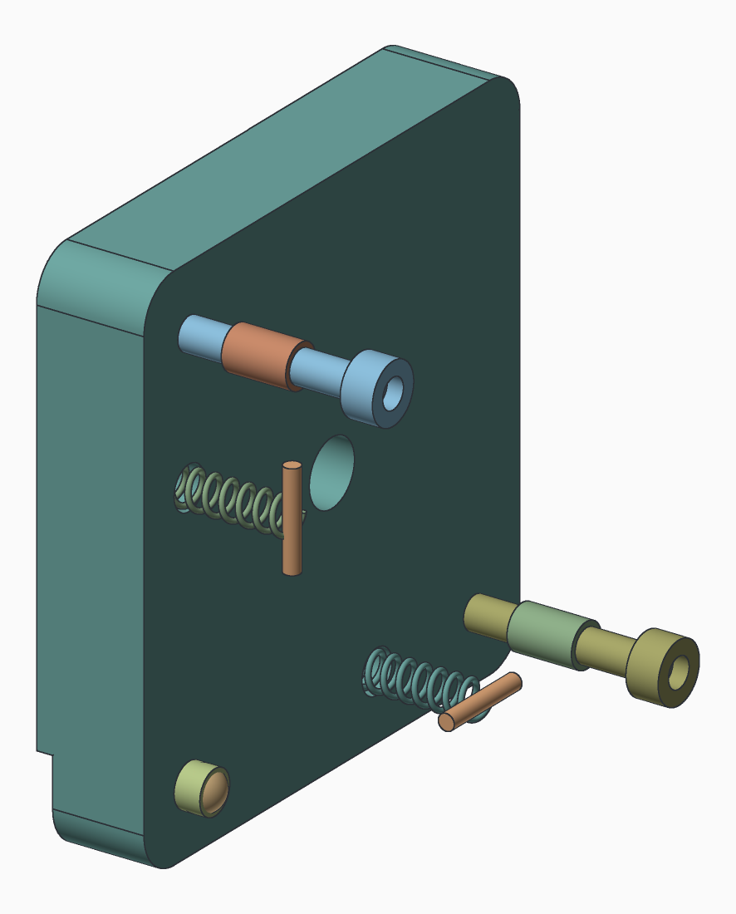
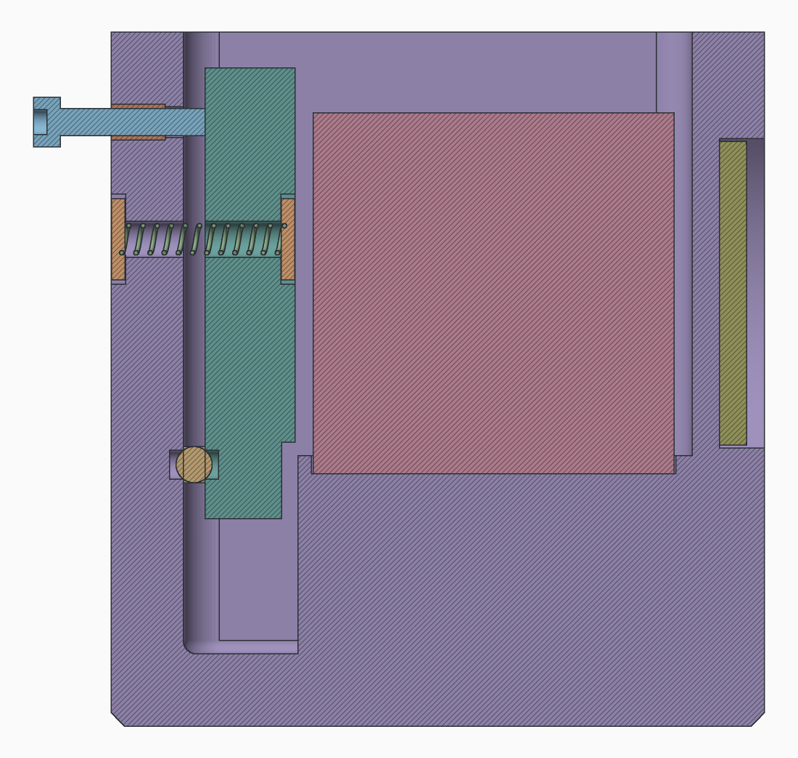

# Shearography head for guitar soundboard modal analysis

A Michelson shearing interferometer in front of a Raspberry Pi Global Shutter Camera (IMX296),
modelled in [Solvent](https://github.com/bmander/geomsolver) and checked with `solventc` v0.1.17.
The head images a **500 mm square** of soundboard from about **1.07 m** through a 40 mm
beamsplitter cube, lit by a 532 nm laser. It bolts to your T-slot frame through four M5 inserts in
its floor.


```
make check     # solve the model; every optics and clearance claim is judged
make stl       # stl/housing.stl, carrier.stl, carriage.stl, lid.stl
make renders   # renders/*.png
```

## Layout

| file | what |
|---|---|
| `head/dims.sv` | every number, and the optics claims that size the cube, mirrors, window and filter |
| `head/prims.sv` | boxes (square, round-cornered, and rounded all over), bores along x/y/z, a slot |
| `head/housing.sv` | the main print: cube recess, fixed-mirror boss, adjuster wall, window, filter pocket |
| `head/carrier.sv` | mirror A's tip/tilt carrier |
| `head/carriage.sv` | the sliding camera plate |
| `head/lid.sv` | lid with a locating lip and the post that holds the cube down |
| `head/optics.sv` | stand-ins for the bought optics (cube, mirrors, filter, pad, camera + lens) |
| `head/hardware.sv` | the hardware: mirror A's pivot ball, adjusters, springs' pins, inserts, every screw |
| `head.sv` | the assembly, with clearance claims between parts |

Axes: x right, y forward to the guitar, z up. The origin is under the cube's centre on the floor,
and the optical axis is 40 mm up. Light from the soundboard enters the front (+y) cube face and
splits to **mirror A** (behind, -y, tip/tilt) and **mirror B** (right, +x, fixed). Both returns
reach the camera on the left (-x). Tilting A shears one image against the other.

## How mirror A tilts

Only mirror A moves. Mirror B is fixed in the boss, and the shear is set by A's tilt relative to
B. A's carrier floats 2.4 mm in front of the back wall and touches it at just three points: a
classic kinematic mount.



- **Pivot**: a Ø4 steel ball sits in a Ø3.2 seat in each face, at the carrier's lower corner on
  the camera side. The ball sets the 2.4 mm gap and is the point the carrier turns about.
- **Horizontal-shear adjuster**: an M3 × 16 screw 38 mm across from the ball. It threads through
  an insert in the back wall, and its tip pushes on the carrier's back. Turning it swings the
  carrier about the vertical line through the ball and the other screw, so the shear runs along x.
- **Vertical-shear adjuster**: the same screw, 38 mm above the ball. It tips the carrier about the
  horizontal line through the ball and the first screw, so the shear runs along z.
- **Springs**: two extension springs, one along the bottom edge and one up the side, pull the
  carrier back onto all three points. Each passes through a Ø4 hole in the carrier and in the wall
  and hooks onto a 1.5 mm pin lying in a groove across the hole: on the carrier's front, and on
  the wall's back. Their combined pull falls inside the triangle of the three contacts, so the
  carrier can't rock off any of them.

Screw an adjuster in and its corner of the carrier comes forward. Back it off and the springs pull
the corner back. A turn is about 28 mm of shear at the soundboard.



The section above is cut through the ball, the side spring and the vertical-shear screw (19 mm
toward the camera from the centre, so beside mirror A rather than through it), seen from the +x
side with the soundboard to the right. The carrier stands between the back wall and the cube;
the ball sits low in the gap between their two seats; the spring runs through both holes from
pin to pin; and the screw's tip meets the carrier's back with its head 5.6 mm off the wall, room
to turn it in. `renders/mount_front.png` shows the carrier's face, with the springs' pins
in their grooves.

## Optics: why the parts are the sizes they are

For a 500 mm square you chose ~1 m and an 8 mm lens. That is a wide field (about ±13° half-angle) for
a cube that sits in *front* of the lens, and it drives the design:

- **Square crop.** The 500 mm field maps onto the sensor's short side (1088 px × 3.45 µm =
  3.75 mm), so the image is the central 1088 × 1088. The long side's extra pixels would need a
  much bigger cube, so they are cropped in software.
- **40 mm cube.** Traced back from the lens's entrance pupil, the field passes through two cube
  lengths of glass. Its footprint at the object face is **34.6 mm**, against a 36 mm clear aperture
  (90%). A 25.4 mm cube would cut off the corners of the field.
- **30 × 30 mm mirrors.** The footprint on each mirror is 21.3 mm square. Its diagonal (30 mm)
  is why 1" round mirrors are not enough.
- **Filter outside the window.** A 532 nm bandpass between lens and cube would push the pupil back
  and cause vignetting, so the filter is a 2" (Ø50.8) disc in a pocket outside the front window.
  It is optional in a dark room.
- **f/8** makes speckle about 10 µm, three pixels. Go no wider than f/5.6.
- **Shear.** An M3×0.5 adjuster at a 38 mm lever gives **≈28 mm of shear per turn** at the
  soundboard. A typical 5–15 mm shear is ⅕ to ½ turn. M3×0.35 fine screws or 1/4-80 adjusters
  give finer control (change `adjust_pitch`).

All of these are value claims in `head/dims.sv`. Change a number, rerun `make check`, and each
claim is re-judged as theorem or refuted.

### The one number to measure: `pupil_depth`

The cube's margin depends on how far the lens's entrance pupil sits behind its front rim. It is
assumed to be **12 mm**, but this is rarely published for CCTV lenses. To find it, hold the lens
at arm's length and look into the front. The iris appears to float at some depth, and that depth
is the pupil. Set `pupil_depth` and `lens_len` (lens plus C–CS spacer) and run `make check`. The
carriage slides ±9 mm, so it takes lenses from 26 to 44 mm long; past that, change `lens_len`. If
`exit_spot <= cube_ca` is refuted, use a lens with a shallower pupil, a 50 mm cube
(`cube := 50mm`), or a longer working distance.

## Bill of materials

| qty | part | notes |
|---|---|---|
| 1 | Cube beamsplitter, **40 mm**, 50R/50T, 400–700 nm: [Edmund #32-506](https://www.edmundoptics.com/p/40mm-50r50t-standard-cube-beamsplitter/2385/) | N-BK7, standard (not polarizing) coating. See below |
| 2 | First-surface mirror, **30 × 30 mm**, enhanced Al, λ/4: [Edmund #63-165](https://www.edmundoptics.com/p/30-x-30mm-enhanced-aluminum-lambda4-mirror/17779/) | 450–650 nm coating covers 532. Designed for 5 mm thick: check yours and set `mirror_t` |
| 1 | 532 nm bandpass filter, Ø50.8 mm, ≤ 5 mm thick | optional |
| 1 | Raspberry Pi Global Shutter Camera | |
| 1 | 8 mm C-mount lens with manual iris, rated for ≥ 1/2.9" | uses the camera's C–CS spacer |
| 1 | Ø4 mm steel ball | the pivot |
| 2 | M3 × 16 adjuster screws (ball-end set screws, or cap screws) | add knobs for fine control |
| 2 | Extension spring, loop ends, 12.5 mm long, 3.5 mm OD, 0.5 mm music wire: [McMaster-Carr 5108N95](https://www.mcmaster.com/5108N95/) (pack of 2) | stretched to 15.8 and 17.3 mm inside the loops; pulls about 7 and 9 N |
| 4 | 1.5 mm pins, ~10 mm long (cut paperclip or dowel) | spring anchors in the grooves |
| 8 | M3 heat-set inserts (Ø4.0 hole × 6 deep) | 2 adjusters, 2 carriage, 4 lid |
| 4 | M5 heat-set inserts (Ø6.4 hole × 6.5 deep) | frame mounting, underneath |
| 4 | M2.5 × 12 screws | camera to carriage, tapped into the print |
| 2 | M3 × 10 + washers | carriage to floor |
| 4 | M3 × 8 | lid |
| 1 | Silicone or felt pad, 24 × 24 × 2 mm | between the lid's post and the cube; squeezed 0.5 mm |
| — | RTV silicone | three dots behind each mirror |

**On the cube.** #32-506 is Edmund's *standard* cube: its 50:50 split varies somewhat with
polarization. That's fine here. Each arm of this Michelson takes one reflection and one
transmission at the hypotenuse, so the two images are equally bright in either polarization. Any
fixed phase offset between the arms is part of the random speckle phase and drops out of the
before/after subtraction. Do **not** use a *polarizing* beamsplitter cube: it would send
orthogonal polarizations down the two arms, and they can't interfere. A true non-polarizing cube
(metal-dielectric coating) costs more and isn't sold at 40 mm. The nearest are 50 mm: Edmund's
VIS non-polarizing cube, or [MKS/Newport 20BC17MB.1](https://np.p1.mks.com/p/20BC17MB.1) at
50.8 mm. Either needs `cube := 50mm` (or 50.8), which reflows the housing. The 30 mm mirrors
still clear it.

**On the mirrors.** Flatness hardly matters here: a static mirror error is the same before and
after, so it cancels. Cheaper first-surface mirrors cut to 30 × 30 mm work too. Avoid back-surface
(household) mirrors, which give a second, ghost reflection.

Hole sizes for the inserts and taps are in `head/dims.sv` (`m3_insert_d`, `m5_insert_d`,
`m25_tap_d`, `fit`). Tune them to your printer and filament.

## Printing (carbon-filled filament)

- Prefer **CF-PETG or CF-ASA** over PA-CF. Nylon absorbs water and creeps, and stability matters
  more here than strength. If you do use nylon, dry it and let the parts settle before aligning.
- **Housing**: print upright, open top up. The window's top edge is a 38 mm bridge. The filter
  pocket's arc overhangs near its top, so use supports there or print the pocket shallower.
- **Carrier**: face (mirror pocket) down. **Carriage**: standing on its foot. **Lid**: upside down,
  lip up.
- **The finish.** The box's corners are rounded 8 mm in plan. The housing's floor edge is
  chamfered 1.5 mm all round, which prints cleanly on the bed and hides elephant's foot. The lid's
  top edges are rounded 2 mm; they sit on the bed too, so the first layer is inset a little and a
  brim helps if they curl. Inside, the walls are filleted 1.5 mm into the floor and 4 mm into one
  another. The carrier's corners and the carriage plate's top corners are rounded 4 mm. The
  carriage's foot and ribs are filleted into its plate, and the ribs into the foot.
- Use high infill (≥ 60%) and ≥ 4 perimeters. Rigidity and mass damp vibration, which matters
  because the head sits near a speaker-driven guitar.

## Assembly and alignment

1. Press the inserts: two adjusters from behind into the back wall, two in the floor for the
   carriage, four in the wall tops for the lid, and four M5 from underneath.
2. **Mirror B**: three RTV dots in the boss pocket, mirror face out, flush with the boss.
   **Mirror A**: the same in the carrier pocket.
3. **Carrier**: put the ball in the back wall's seat (low, toward the camera). Hook the springs
   through the carrier and the wall onto pins in the grooves, then run the two adjuster screws in
   until they just touch. The springs should pull the carrier onto the ball and both screws.
4. **Cube**: drop it into the 2 mm recess in the pedestal, which fixes its position and turn.
   With the lid on, the post presses it down through the pad. Orient the **coated hypotenuse
   from the front-left corner to the back-right corner** seen from above, with the camera on the
   left. To check, cover both mirrors with card: the camera's image should go dark. If it still
   sees the soundboard, it is looking straight off the hypotenuse; turn the cube a quarter turn.
5. **Camera**: set the back focus on the bench, then bolt the board to the carriage with the
   ring through the bore. Slide the carriage until the lens front is ~3 mm off the cube and lock
   the two M3 screws. Focus at 1.07 m and stop down to f/8.
6. **Zero shear**: aim at a textured target or the guitar under room light, and turn the two
   adjusters until the doubled image merges into one. Then dial in shear with one screw: the
   lower-right screw seen from behind shears horizontally, the upper-left vertically.
7. Stick the pad on the cube's top (or the lid's post), then set the lid on. Its 3 mm lip drops
   inside the walls and around the mirror boss with 0.2 mm to spare, so it finds its own place
   and seals the joint against stray light. Screw it down: it clamps the cube. The cube only rests in its recess with the lid off, so don't tip the head while
   aligning. Run the ribbon out of the slot low in the left (-x) wall.

## Using it for modes

With no phase stepper, two capture modes work:

- **Time-averaged subtraction.** Grab a reference frame with the top at rest, then frames while
  driving a sinusoid. |difference| shows correlation fringes, and the nodal lines stay dark
  (unchanged) where the top doesn't move. Sweep frequency to find the modes.
- **Stroboscopic.** The global shutter lets you gate the exposure, or pulse the laser via TTL, at
  a fixed phase of the drive. Subtracting two phases (0° and 180°) gives fringes of the
  deflection *gradient* along the shear, which is what shearography measures.

Shear along the soundboard's length or across it highlights different modes, so try both
screws.

## Not yet covered

- Laser mount and beam expander, the guitar fixture, and excitation (head only, as scoped).
- No piezo phase stepper. If you add one later, the carrier would need a different back.
- The camera stand-in is only an envelope. Check it against your actual lens's diameter
  (`lens_d`) and length (`lens_len`).
